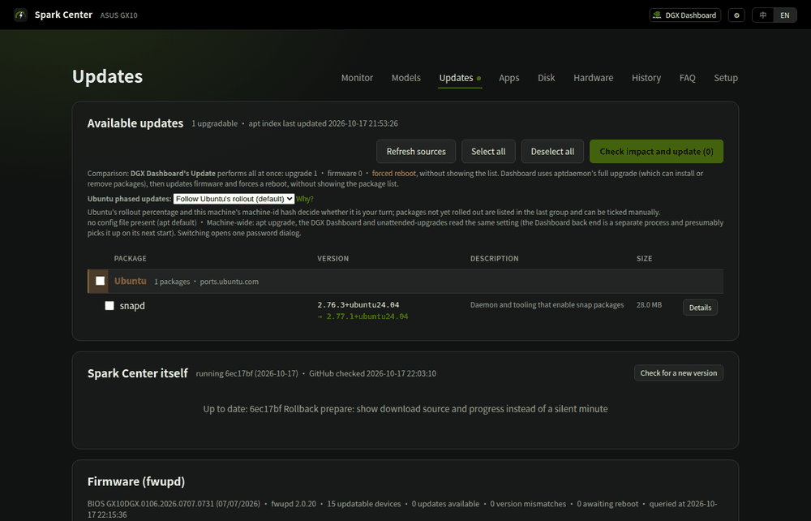
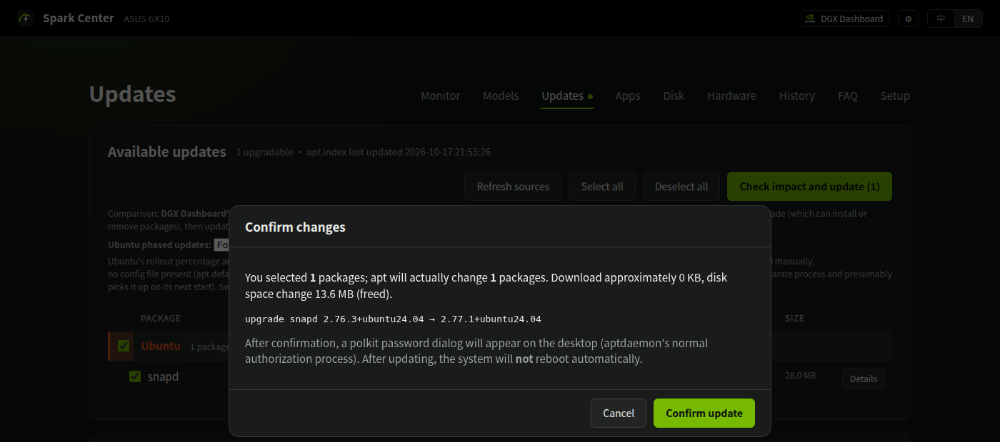
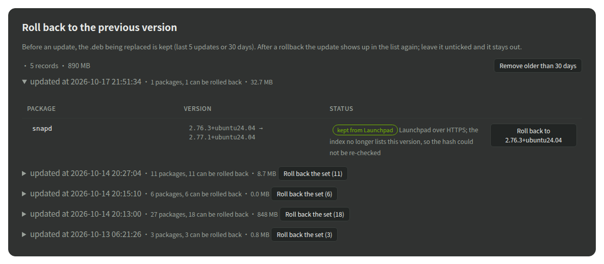
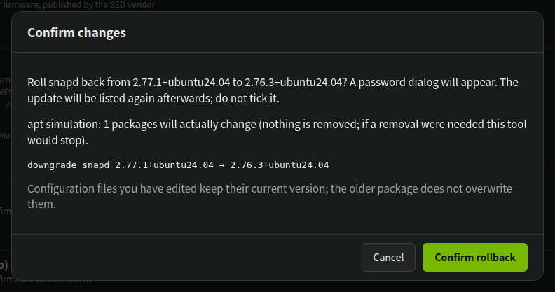
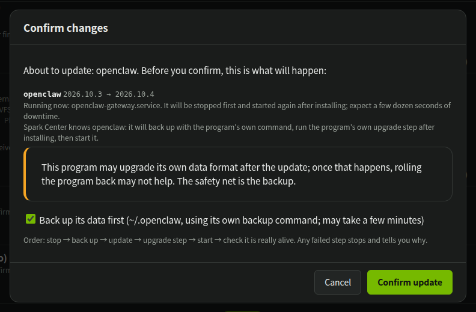
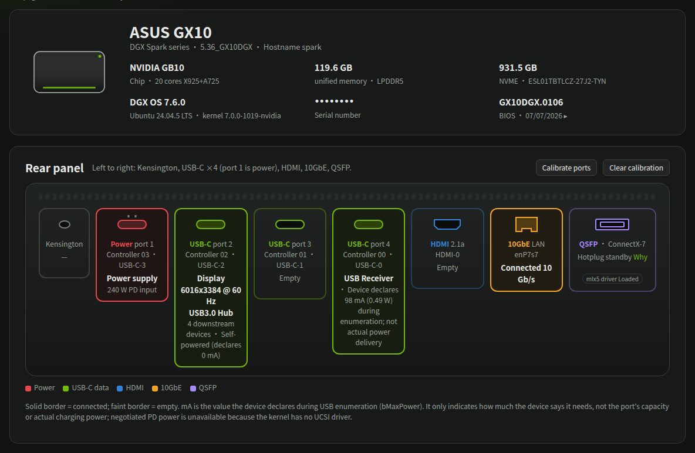
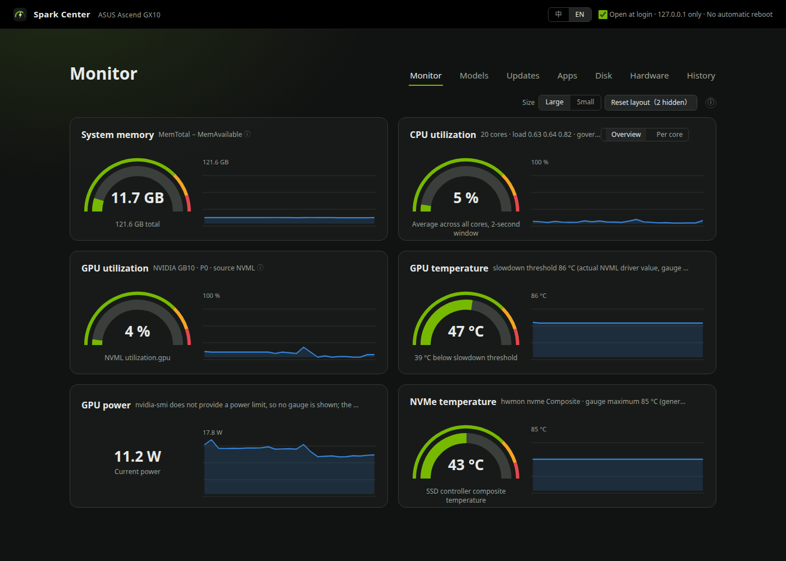
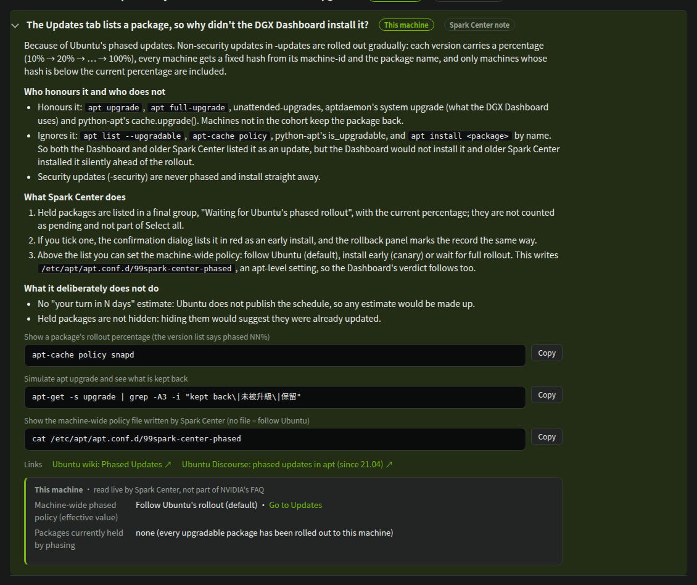

# Spark Center

**A local control panel for NVIDIA GB10 machines** (DGX Spark, ASUS Ascent GX10, and the Dell / HP / Gigabyte / Acer variants) that replaces the stock Dashboard's one-button update with a picker that shows what it will touch, keeps the old version so you can roll back, and never reboots on its own.

The UI is bilingual (English and Traditional Chinese). Nothing leaves the machine: it binds to `127.0.0.1`, runs as your user, and asks for your password only when apt, snap or firmware needs it.



## Install

```sh
git clone https://github.com/tiong6/spark-center.git
cd spark-center
./install.sh
```

That is all. It writes a systemd user unit and an app-menu entry under your home directory (no root), starts the service on `127.0.0.1:11001` (or the next free port, and says so), and opens the window. The ⚙ Setup tab lists the optional extras (serial numbers, NVMe health, Node upgrades, open at login) with what each one gives and costs.

**Not ready to let a tool you just met run apt?** Start it read-only: every change is refused and the buttons are hidden, while monitoring, hardware, disk and the update *list* all work.

```sh
systemctl --user edit spark-center    # under [Service] add:  Environment=SPARK_CENTER_READONLY=1
systemctl --user restart spark-center
```

Requirements: Ubuntu 24.04 / DGX OS 7.x on aarch64; everything it needs ships with DGX OS.

## Three things the stock Dashboard cannot do

### 1. Show you what an update will do, and let you choose

The Dashboard's **Update** button upgrades every apt package it can find, including Chrome and anything else you added a repository for, then reboots. Since Dashboard 0.39 (October 2026) it shows the list of packages, but it is still all or nothing: no picking, no dependency preview, no roll-back, and when a firmware flash fails silently it still reports success.

Spark Center lists the packages grouped by source, runs the dependency simulation first, and tells you exactly what will change, what your selection drags in, and whether a reboot is actually needed. Packages Ubuntu is still rolling out in phases are kept apart and marked, instead of being installed ahead of the rollout or listed as updates that then refuse to install. If Ubuntu's release-upgrade prompt is on (DGX OS has no supported in-place upgrade to 26.04, and the Software & Updates menu can switch the prompt back on), every tab's top bar shows a red badge (re-checked when you return to the window and every few minutes) and the Updates tab has the switch to turn it off. Firmware is read from fwupd itself, so a flash that reported success but did not change the version shows up as a mismatch.



### 2. Roll back

Before every update it keeps the `.deb` of each version being replaced (from the apt cache, the repository, or Launchpad; downloads are checked against the apt index). A bad update is undone from the same tab, one package or the whole set, after the same simulate-and-confirm step.





### 3. Update the CLI tools apt knows nothing about, safely

The npm global tools (Claude Code, OpenClaw, Gemini CLI…) get their own panel. Updating a tool that runs as a service is one transaction: stop, back up with the program's own command, install, run its migration step, start, and wait until it stays alive. If it does not come back, the job card says why in plain words and offers the way out as buttons.



## Also in the box

**Hardware** — an "About this machine" header and a rear-panel diagram that shows what is plugged into each USB-C port (built in for the ASUS Ascent GX10; other GB10 models calibrate by plugging something in), then DMI, memory modules, NVMe SMART, USB tree, Bluetooth, printers and PCI link speeds.



**Monitor** — DGX-style gauges sampled every 2 s: unified memory, CPU, GPU via NVML with the driver's real slowdown threshold, power, NVMe temperature, network and Wi-Fi quality. It detects the "GPU stuck at 611 MHz" failure and alerts on sustained overheating.



**FAQ** — NVIDIA's pinned *DGX Spark / GB10 FAQ* in both languages, searchable, with a separate **This machine** box per question showing what is true here, kept apart from NVIDIA's text.



**Models**, **Apps** (apt, snap and flatpak with icons and one-click snap/flatpak updates), **Disk** (what is eating space, whitelist cleanup), **History**. The full tab-by-tab reference, the optional root-owned pieces, what the tool deliberately does not do, and the one trade-off to know about are in **[docs/FEATURES.md](docs/FEATURES.md)**.

## Design rules

These are deliberate, and they are why the tool exists:

- **Never reboot on its own.** It reports whether a reboot is needed and leaves the decision to you.
- **Never claim what it cannot read.** Anything unavailable shows `—` with the reason. Guesses are labelled as guesses.
- **Ask for privilege only when needed.** It runs as you, not as root. apt goes through aptdaemon and polkit; snap goes through pkexec. Compare with the stock dashboard, whose helper runs as root permanently.
- **`127.0.0.1` only.** This page can install packages and delete models. Do not expose it.
- **No external dependencies.** Python 3 standard library plus what DGX OS already ships (`python3-apt`, `python3-aptdaemon`, `python3-gi`), `ctypes` into `libnvidia-ml.so`, and hand-written HTML, CSS and JavaScript with inline SVG, served straight from the repo. No pip, no npm, no CDN, no build step.


## Keeping it up to date, and removing it

Your clone does not update by itself, but it tells you when it should: the service checks GitHub every six hours (`git fetch`, read-only), and when there are new commits the top bar shows **Spark Center update available** and the Updates tab lists them under *Spark Center itself*, with an **Update and restart** button that runs `git pull --ff-only` and restarts the service (no root). It refuses to pull if you have modified tracked files or have local commits, so nothing of yours gets overwritten, and it is blocked while a job is running or in read-only mode. If an update changes the optional Node-upgrade helper, the panel reminds you to re-run its `sudo install` line. Copies that were not installed with `git clone` cannot use this and simply do not show the panel.

To remove it:

```sh
./uninstall.sh
```

removes the user service, the app-menu entry, icons and the autostart entry, and prints the `sudo rm` lines for the optional root-owned pieces if you installed them. The repository directory, including `data/`, is left for you to delete.

## Changelog

See [CHANGELOG.md](CHANGELOG.md) (entries are in Chinese with an English summary per release).

## License

MIT, see [LICENSE](LICENSE). This is an independent, unofficial tool with no affiliation with NVIDIA or ASUS.
